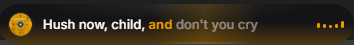
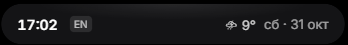
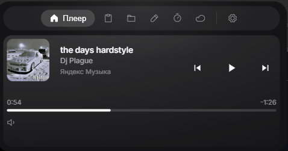
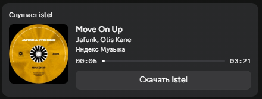

## Istel
*[Распространяется по лицензии MIT](./LICENSE)*

Оверлей-островок для рабочего стола Windows — музыка, буфер обмена, полка, закреплённые ярлыки, календарь, Pomodoro, погода, батарея, индикаторы приватности и Discord Rich Presence в одной анимированной капсуле.

 

## Скриншоты

   
  Свёрнутый бар с музыкой

   
  Свёрнутый бар без музыки

   
  Раскрытый остров с музыкой

   
  Discord Rich Presence

## Возможности

| | |
|---|---|
| **Музыка** | SMTC (Spotify, Apple Music, браузеры), play/pause, next/prev, перемотка, обложка с синхро-цветом, Discord RPC, текст песни (lrclib → lyrics.ovh) |
| **Островок** | прозрачный оверлей поверх окон, раскрытие по hover/клику, per-tab размеры, «пилюля»/«у края», масштаб, скругление, край, тень, кромка, темы, акцент, окно под масштаб |
| **Буфер** | история текста/картинок/файлов, вставка, удаление, очистка, сохранение картинки, QR, «в заметки» |
| **Полка и ярлыки** | полка с миниатюрами и drag-and-drop, закреплённые ярлыки (добавить/запустить/удалить) |
| **Фокус** | Pomodoro: работа/короткий/длинный перерыв, старт/пауза/сброс, звук, авто-переход, DND |
| **Система** | погода, батарея, громкость, Caps/раскладка, приватность (камера/микрофон), уведомления, баннеры скачиваний, автозапуск, автообновление |
| **Интеграции** | события календаря, активное окно (workspace) |

## Установка

Скачай **Istel Setup 1.0.0.exe** со страницы [Releases](../../releases) и запусти.

Или запуск из исходников:

    git clone https://github.com/rud1x/Istel.git
    cd Istel
    npm install
    npm run dev

Требуется Windows 10/11 и Node.js 18+.

## Сборка

    npm run pack    # распакованная сборка -> dist-electron/win-unpacked/Istel.exe
    npm run dist    # установщик NSIS -> dist-electron/Istel Setup 1.0.0.exe

Windows: ошибка «Cannot create symbolic link» при сборке

Если electron-builder падает при распаковке winCodeSign — включи режим разработчика или распакуй кэш вручную без симлинков:

    $cache = "$env:LOCALAPPDATA\electron-builder\Cache\winCodeSign"
    Remove-Item "$cache\*" -Recurse -Force -ErrorAction SilentlyContinue
    7z x "winCodeSign-2.6.0.7z" "-o$cache\winCodeSign-2.6.0" -snl- -y

## Стек

| Слой | Технология |
|------|------------|
| Оболочка | Electron 41 |
| Интерфейс | React 19 + Vite 8 |
| Анимации | Framer Motion |
| Иконки | Phosphor Icons |
| Системная интеграция | PowerShell / WinRT (SMTC, громкость, батарея, уведомления) |
| Упаковка | electron-builder (NSIS) |

## Структура

    Istel/
    ├─ electron/     # Основной процесс — окно, музыка, буфер, pomodoro, discord
    ├─ src/          # Рендерер — React-компоненты, стили, утилиты
    ├─ assets/       # Логотипы, иконки, скриншоты
    ├─ scripts/      # Скрипты dev и генерации иконок
    └─ package.json

## Благодарности

- Windows SMTC, WinRT и PowerShell за системную интеграцию
- [Phosphor Icons](https://phosphoricons.com)
- [lrclib](https://lrclib.net) и [lyrics.ovh](https://lyrics.ovh) за текст песен
